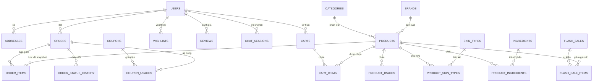

# 🌸 BEAUTYSHOP - NỀN TẢNG THƯƠNG MẠI ĐIỆN TỬ MỸ PHẨM CAO CẤP & AI BEAUTY ADVISOR

> **Đồ Án Tốt Nghiệp / Báo Cáo Thực Tập Chuyên Ngành Công Nghệ Thông Tin - Kỹ Thuật Phần Mềm**  
> **Đề tài:** Xây dựng Website Tư Vấn và Bán Mỹ Phẩm Thông Minh Tích Hợp AI  
> **Công nghệ:** PHP 8.0+, MySQL 8.0 (InnoDB), Bootstrap 5, Chart.js, Google Gemini API  

---

## 📑 MỤC LỤC
1. [Giới Thiệu Đề Tài & Điểm Nổi Bật](#1-giới-thiệu-đề-tài--điểm-nổi-bật)
2. [Kiến Trúc Kỹ Thuật (Tech Stack)](#2-kiến-trúc-kỹ-thuật-tech-stack)
3. [Thiết Kế Cơ Sở Dữ Liệu MySQL & ERD](#3-thiết-kế-cơ-sở-dữ-liệu-mysql--erd)
4. [Tài Khoản Demo Hệ Thống](#4-tài-khoản-demo-hệ-thống)
5. [Hướng Dẫn Cài Đặt & Chạy Website Trên Windows](#5-hướng-dẫn-cài-đặt--chạy-website-trên-windows)
6. [Hệ Thống Tính Năng Nghiệp Vụ Thực Tế](#6-hệ-thống-tính-năng-nghiệp-vụ-thực-tế)
7. [Trợ Lý AI Beauty Advisor (Dual-Mode)](#7-trợ-lý-ai-beauty-advisor-dual-mode)
8. [Cổng Quản Trị Hệ Thống (Admin Portal)](#8-cổng-quản-trị-hệ-thống-admin-portal)
9. [Kịch Bản Demo Thuyết Trình Bảo Vệ Đồ Án](#9-kịch-bản-demo-thuyết-trình-bảo-vệ-đồ-án)
10. [Kiểm Thử Tự Động (Automated Testing)](#10-kiểm-thử-tự-động-automated-testing)

---

## 1. GIỚI THIỆU ĐỀ TÀI & ĐIỂM NỔI BẬT

**BeautyShop** là nền tảng e-commerce mỹ phẩm chính hãng toàn diện được thiết kế theo phong cách sang trọng (*luxury rose-gold & cream aesthetic*), giải quyết bài toán tư vấn chăm sóc da chuyên sâu và thương mại hóa sản phẩm làm đẹp:

- **100% Cơ sở dữ liệu quan hệ thực tế:** 25 bảng và View MySQL 8.0 InnoDB với khóa ngoại (`Foreign Keys`), ràng buộc toàn vẹn, chỉ mục tối ưu hóa (`Indexes`), giao dịch nghiêm ngặt (`ACID Transactions`).
- **Bảo toàn tồn kho & Chống bán vượt (Overselling Prevention):** Áp dụng `SELECT FOR UPDATE` khi kiểm tra kho hàng trong giỏ; tự động trừ tồn kho khi tạo đơn và **hoàn trả 100% số lượng về kho hàng khi đơn bị hủy**.
- **Lưu trữ Snapshot giao dịch:** Đơn hàng lưu vết bất biến về tên, giá, số lượng tại thời điểm mua, độc lập với việc sản phẩm bị sửa đổi sau này.
- **Trợ lý AI Beauty Advisor thế hệ mới:** Tích hợp **Google Gemini API** kết hợp cơ chế **Grounding dữ liệu kho hàng MySQL**. AI không bị ảo giác bịa đặt sản phẩm, đưa ra phác đồ chăm sóc da chuẩn y khoa và đính kèm liên kết sản phẩm có thể bấm mua ngay.
- **Hệ thống thanh toán kép:** Hỗ trợ nhận hàng thanh toán tiền mặt (**COD**) và quét mã chuyển khoản ngân hàng chuẩn quốc gia (**VietQR Napas247**) tự động tạo mã QR có số tiền và nội dung đơn.
- **Cá nhân hóa trải nghiệm:** Tự động đề xuất theo 5 loại da (*Da dầu, Khô, Nhạy cảm, Hỗn hợp, Mụn*), công cụ tạo chu trình dưỡng da sáng/tối (*Routine Builder*), so sánh tối đa 3 mỹ phẩm (*Compare Matrix*).

---

## 2. KIẾN TRÚC KỸ THUẬT (TECH STACK)

| Tầng hệ thống | Công nghệ sử dụng | Mục đích & Chi tiết |
| :--- | :--- | :--- |
| **Backend Core** | PHP 8.0+ (PDO Extension) | Xử lý logic, routing, session bảo mật, giao dịch cơ sở dữ liệu |
| **Cơ sở dữ liệu** | MySQL 8.0+ (InnoDB Engine) | Lưu trữ quan hệ ACID, chuẩn hóa dữ liệu 3NF, ràng buộc toàn vẹn |
| **Trí tuệ nhân tạo (AI)** | Google Gemini API + Rule Engine | Dual-Mode: Gọi Gemini API với System Instructions & Grounding Catalog |
| **Frontend UI/UX** | HTML5, CSS3, Bootstrap 5.3 | Giao diện chuẩn Luxury Beauty E-commerce, Responsive 100% |
| **Thư viện UI** | Swiper.js, Chart.js, Bootstrap Icons | Slider banner, biểu đồ thống kê doanh thu, icon hệ thống |
| **Bảo mật** | Bcrypt, PDO Prepared Statements | Băm mật khẩu một chiều, ngăn chặn 100% SQL Injection & XSS |

---

## 3. THIẾT KẾ CƠ SỞ DỮ LIỆU MYSQL & ERD

Hệ thống cơ sở dữ liệu `beauty_shop` được thiết kế chặt chẽ, tối ưu cho môi trường thương mại điện tử thực tế:



### Các bảng dữ liệu cốt lõi:
1. `users`: Quản lý tài khoản khách hàng, nhân viên, quản trị viên (`role`: customer, admin; `status`: active, banned).
2. `addresses`: Sổ địa chỉ nhận hàng của người dùng (hỗ trợ đánh dấu địa chỉ mặc định).
3. `categories`: Danh mục mỹ phẩm (Chăm sóc da, Trang điểm, Chống nắng, Nước hoa...).
4. `brands`: Thương hiệu mỹ phẩm chính hãng kèm quốc gia xuất xứ.
5. `skin_types` & `product_skin_types`: Bảng chuẩn hóa 5 nhóm loại da và quan hệ đa-đa với mỹ phẩm.
6. `ingredients` & `product_ingredients`: Thành phần hoạt chất (Niacinamide, BHA, HA, Vitamin B5...).
7. `products`: Bảng sản phẩm toàn diện chứa giá niêm yết, giá bán, tồn kho, số lượng đã bán, dung tích, công thức, đánh giá trung bình.
8. `orders` & `order_items`: Lưu vết đơn hàng và snapshot giá trị tại thời điểm mua hàng.
9. `order_status_history`: Ghi vết lịch sử chuyển đổi trạng thái đơn hàng (pending -> confirmed -> shipping -> completed / cancelled).
10. `coupons` & `coupon_usages`: Hệ thống voucher chiết khấu theo % hoặc số tiền cố định, đơn tối thiểu, giới hạn lượt dùng.
11. `flash_sales` & `flash_sale_items`: Chiến dịch flash sale theo khung giờ với giá ưu đãi riêng biệt.
12. `reviews`: Đánh giá 1-5 sao, bình luận, kiểm duyệt và phản hồi từ quản trị viên.
13. `chat_sessions` & `chat_messages`: Lưu vết lịch sử tư vấn AI khi khách hàng truy cập.

---

## 4. TÀI KHOẢN DEMO HỆ THỐNG

Tất cả mật khẩu đều được băm bằng thuật toán **Bcrypt** an toàn:

| Loại tài khoản | Tên đăng nhập | Mật khẩu | Quyền hạn & Chức năng |
| :--- | :--- | :--- | :--- |
| **Quản trị viên (Admin)** | `admin` | `admin123` | Toàn quyền Quản trị: Dashboard doanh thu, Quản lý đơn, Sản phẩm, Danh mục, Voucher, Flash Sale, Người dùng, Duyệt review |
| **Quản lý kho (Manager)** | `manager` | `admin123` | Quản trị viên phụ trách kho vận và duyệt đơn |
| **Khách hàng 1 (VIP)** | `lananh` | `customer123` | Khách quen có sẵn đơn hàng, danh sách yêu thích và lịch sử mua sắm |
| **Khách hàng 2 (Mới)** | `minhthu` | `customer123` | Khách hàng trải nghiệm mua sắm, áp mã giảm giá và chat với AI |

> 💡 **Mẹo:** Trang Đăng nhập (`login.php`) có sẵn các nút bấm chọn nhanh tài khoản mẫu, giúp hội đồng chấm thi và giảng viên đăng nhập ngay lập tức mà không cần gõ bàn phím.

---

## 5. HƯỚNG DẪN CÀI ĐẶT & CHẠY WEBSITE TRÊN WINDOWS

### Yêu cầu tiên quyết:
- Đã cài đặt **XAMPP** (hoặc PHP 8.0+ và MySQL 8.0 độc lập).
- Trình duyệt hiện đại: Chrome, Edge, Brave, Cốc Cốc.

### Các bước thực hiện:

#### Bước 1: Khởi động MySQL
Mở **XAMPP Control Panel** và nhấn nút **Start** tại mục **MySQL**.  
*(Hoặc chạy MySQL CLI/Service nếu sử dụng bản độc lập).*

#### Bước 2: Tự động khởi tạo Cơ sở dữ liệu (Migration & Seed Data)
Mở cửa sổ PowerShell hoặc Command Prompt tại thư mục dự án `C:\web\BeautyShop`:

```powershell
# Chạy file thiết lập database tự động (Tạo schema và nạp 36 sản phẩm mẫu phong phú)
& "C:\xampp\php\php.exe" "database\setup_db.php"
```

*Kết quả hiển thị: Schema và 36 sản phẩm, 5 đơn hàng mẫu, 5 mã voucher đã được khởi tạo thành công.*

#### Bước 3: Cấu hình biến môi trường `.env` (Tùy chọn)
File `.env` đã được cấu hình sẵn tại thư mục gốc:
```env
DB_HOST=127.0.0.1
DB_PORT=3306
DB_NAME=beauty_shop
DB_USER=root
DB_PASS=

# Điền API Key để kích hoạt trực tiếp Google Gemini AI (Nếu để trống hệ thống tự chuyển sang Grounding Fallback thông minh)
GEMINI_API_KEY=
GEMINI_MODEL=gemini-1.5-flash
```

#### Bước 4: Khởi động Web Server
Chạy lệnh khởi động máy chủ PHP tích hợp:
```powershell
& "C:\xampp\php\php.exe" -S 127.0.0.1:8000 -t "C:\web\BeautyShop"
```

#### Bước 5: Truy cập website
Mở trình duyệt và truy cập:
- **Trang chủ Khách hàng:** [http://127.0.0.1:8000/](http://127.0.0.1:8000/) hoặc [http://127.0.0.1:8000/php/index.php](http://127.0.0.1:8000/php/index.php)
- **Cổng Quản trị Admin:** [http://127.0.0.1:8000/php/admin_dashboard.php](http://127.0.0.1:8000/php/admin_dashboard.php)

---

## 6. HỆ THỐNG TÍNH NĂNG NGHIỆP VỤ THỰC TẾ

### Phía Khách hàng (Storefront):
1. **Trang chủ đẳng cấp:**
   - Hero Banner sang trọng, giới thiệu cam kết 100% mỹ phẩm chính hãng.
   - Đồng hồ đếm ngược Flash Sale thời gian thực (*Live Countdown Timer*).
   - Khám phá mỹ phẩm thông minh theo từng loại da (*Skin Type Explorer*).
   - Sản phẩm bán chạy nhất (*Best Sellers*) và Hàng mới về (*New Arrivals*).
2. **Bộ lọc danh mục & Tìm kiếm đa chiều (`products.php`):**
   - Lọc theo Danh mục, Thương hiệu đối tác, Nhóm loại da, Khoảng giá.
   - Sắp xếp: Giá tăng dần, Giá giảm dần, Mới nhất, Bán chạy nhất.
3. **Chi tiết mỹ phẩm chuyên sâu (`product_detail.php`):**
   - Trạng thái tồn kho tức thì, huy hiệu giảm giá.
   - Phân tích chi tiết thành phần hoạt chất (*Ingredients Matrix*) và cách sử dụng.
   - Tab đánh giá khách hàng đã xác minh.
   - Thêm vào giỏ hàng hoặc Mua ngay (*Buy Now*).
4. **Giỏ hàng & Khuyến mãi (`cart.php`):**
   - Tăng/giảm số lượng sản phẩm bằng AJAX tức thì.
   - Áp dụng mã giảm giá (`api_apply_coupon.php`) với kiểm tra điều kiện giá trị đơn tối thiểu, thời hạn, giới hạn số lần dùng.
5. **Thanh toán an toàn ACID (`checkout.php`):**
   - Khóa bản ghi tồn kho (`FOR UPDATE`) tránh bán vượt tồn kho.
   - Hỗ trợ thanh toán **COD** và chuyển khoản nhanh **VietQR** (tự động tạo QR Napas247 chính xác số tiền).
   - Snapshot lưu trữ bất biến giá và tên sản phẩm.
6. **Quản lý đơn hàng & Hoàn trả kho (`my_orders.php`, `order_detail.php`):**
   - Theo dõi trạng thái đơn hàng theo thời gian thực.
   - Cho phép khách hàng hủy đơn khi ở trạng thái Chờ xử lý (`pending`) -> **Tự động hoàn trả số lượng về kho hàng**.
7. **Cá nhân hóa & Tiện ích:**
   - **Routine Builder (`routine_builder.php`):** Xây dựng chu trình dưỡng da sáng và tối cá nhân hóa.
   - **So Sánh Mỹ Phẩm (`compare.php`):** So sánh bảng thông số, dung tích, giá thành, công thức giữa tối đa 3 sản phẩm.
   - **Danh sách yêu thích (`wishlist.php`):** Lưu trữ sản phẩm yêu thích bằng AJAX.

---

## 7. TRỢ LÝ AI BEAUTY ADVISOR (DUAL-MODE)

Hệ thống tư vấn làm đẹp được xây dựng bằng kiến trúc **Dual-Mode Engine** độc quyền (`php/ai_advisor_service.php`):

1. **Chế độ 1: Google Gemini API Trực Tiếp (Khi có API Key):**
   - Gọi trực tiếp mô hình `gemini-1.5-flash` qua HTTP cURL backend.
   - Đính kèm **Grounding Context** (danh mục sản phẩm có trong kho của BeautyShop) vào prompt hệ thống.
   - AI chỉ tư vấn sản phẩm đang có trong kho, tuyệt đối không bịa đặt sản phẩm ngoài đời thực.
2. **Chế độ 2: Smart Rule-Based Grounding Engine (Khi chưa có API Key):**
   - Tự động kích hoạt khi người dùng chạy offline hoặc chưa cấu hình API Key.
   - Phân tích từ khóa câu hỏi (Loại da, vấn đề mụn, nám, thâm, cấp ẩm...) và truy vấn các sản phẩm thực tế từ CSDL MySQL để đưa ra phác đồ tư vấn chuẩn y khoa.
   - Đảm bảo đồ án **luôn luôn chạy demo mượt mà 100% trong mọi tình huống**, không lo lỗi kết nối mạng hay hết quota API.

---

## 8. CỔNG QUẢN TRỊ HỆ THỐNG (ADMIN PORTAL)

Toàn bộ hệ thống quản trị nằm trong thư mục `php/` và được bảo vệ nghiêm ngặt:

1. **Dashboard Thống kê trực quan (`admin_dashboard.php`):**
   - Biểu đồ cột Chart.js doanh thu thực tế 6 tháng gần nhất (chỉ tính các đơn thành công).
   - Biểu đồ tròn cơ cấu trạng thái đơn hàng.
   - Cảnh báo tồn kho sắp hết hàng (&le; 5 sản phẩm).
2. **Quản lý Đơn hàng (`manage_orders.php`):**
   - Bộ lọc trạng thái: Chờ xử lý, Đã xác nhận, Đang giao, Hoàn tất, Đã hủy.
   - Chuyển trạng thái đơn hàng theo quy trình thực tế.
   - Hủy đơn kèm cơ chế hoàn kho hàng tự động và ghi log vào `order_status_history`.
   - Xem chi tiết đơn hàng dạng Popup Modal và in phiếu xuất kho.
3. **Quản lý Mỹ phẩm (`manage_products.php`, `add_product.php`, `edit_product.php`):**
   - Thêm mới, chỉnh sửa thông tin sản phẩm, tải lên ảnh sản phẩm.
   - Gán loại da phù hợp, danh mục, thương hiệu, giá niêm yết, giá khuyến mãi.
   - Xóa an toàn: Chuyển sang ẩn (Soft Delete) nếu sản phẩm đã phát sinh trong đơn hàng.
4. **Quản lý Danh mục & Thương hiệu (`manage_categories.php`):**
   - Quản lý danh mục và thương hiệu đối tác, thống kê số lượng mỹ phẩm trực thuộc.
5. **Quản lý Voucher (`manage_coupons.php`):**
   - Tạo mã giảm giá theo %, số tiền cố định, mức giảm tối đa, giới hạn lượt dùng, thời gian bắt đầu và kết thúc.
6. **Quản lý Flash Sale (`manage_flash_sales.php`):**
   - Cấu hình khung giờ khuyến mãi vàng, thêm bớt sản phẩm tham gia sale và giá ưu đãi đặc biệt.
7. **Quản lý Thành viên (`manage_users.php`):**
   - Danh sách người dùng, thống kê số đơn đã đặt và tổng chi tiêu.
   - Khóa/Mở khóa tài khoản, phân quyền quản trị viên, đặt lại mật khẩu.
8. **Kiểm duyệt Đánh giá (`manage_reviews.php`):**
   - Duyệt/Ẩn đánh giá công khai, trả lời phản hồi khách hàng, tự động tính lại điểm trung bình sao trên sản phẩm.

---

## 9. KỊCH BẢN DEMO THUYẾT TRÌNH BẢO VỆ ĐỒ ÁN

Để đạt điểm tối đa khi bảo vệ trước Hội đồng chấm thi, sinh viên có thể trình diễn theo quy trình 5 bước mẫu sau:

- **Bước 1: Giới thiệu giao diện & Trải nghiệm người dùng:**
  - Mở trang chủ [http://127.0.0.1:8000/](http://127.0.0.1:8000/), giới thiệu phong cách thiết kế sang trọng, banner, countdown flash sale, khám phá theo loại da.
- **Bước 2: Trải nghiệm AI Beauty Advisor:**
  - Nhấp vào biểu tượng Chat AI nổi góc màn hình hoặc truy cập [http://127.0.0.1:8000/php/ai_advisor.php](http://127.0.0.1:8000/php/ai_advisor.php).
  - Chọn nút gợi ý *"Tôi da dầu mụn thì nên dùng kem dưỡng nào?"*.
  - Chỉ ra cách AI phân tích hoạt chất (B5, Centella, BHA) và gợi ý đúng các sản phẩm từ database với giá bán và link chi tiết.
- **Bước 3: Mua sắm & Áp mã giảm giá:**
  - Bấm thêm sản phẩm vào giỏ hàng, mở Giỏ hàng [http://127.0.0.1:8000/php/cart.php](http://127.0.0.1:8000/php/cart.php).
  - Nhập mã voucher `BEAUTYNEW` và bấm Áp dụng (hiển thị giảm ngay 10%).
  - Bấm Thanh toán, chọn phương thức VietQR (xem mã QR chuyển khoản sinh tự động) hoặc COD. Đặt hàng thành công!
- **Bước 4: Chứng minh tính toàn vẹn CSDL (ACID & Hoàn kho):**
  - Mở đơn hàng vừa đặt trong mục Đơn hàng của tôi.
  - Bấm nút "Hủy đơn hàng".
  - Mở bảng sản phẩm kiểm tra: Số lượng tồn kho được tự động hoàn trả nguyên vẹn về kho hàng.
- **Bước 5: Thuyết minh Cổng Quản trị Admin:**
  - Đăng nhập bằng tài khoản `admin` / `admin123`.
  - Mở Dashboard xem biểu đồ doanh thu Chart.js, quản lý danh sách đơn hàng, xem modal chi tiết đơn, quản lý flash sale và mã giảm giá.

---

## 10. KIỂM THỬ TỰ ĐỘNG (AUTOMATED TESTING)

Dự án tích hợp sẵn kịch bản kiểm thử tự động toàn diện `test_e2e.php` kiểm tra toàn bộ 13 tiêu chí kỹ thuật:

```powershell
& "C:\xampp\php\php.exe" "c:\web\BeautyShop\test_e2e.php"
```

**Kết quả kiểm thử đạt 13/13 tiêu chí:**
```text
========================================================
      BEAUTYSHOP AUTOMATED E2E INTEGRATION TEST         
========================================================
 [PASS] Kết nối cơ sở dữ liệu MySQL thành công (beauty_shop)
 [PASS] Đầy đủ các bảng dữ liệu cốt lõi (25 tables tìm thấy)
 [PASS] Tài khoản Quản trị 'admin' verify password thành công
 [PASS] Tài khoản Khách hàng 'lananh' verify password thành công
 [PASS] Kho mỹ phẩm sẵn có dữ liệu phong phú (36 sản phẩm thực tế)
 [PASS] Đầy đủ danh mục mỹ phẩm (7 danh mục)
 [PASS] Đầy đủ thương hiệu mỹ phẩm (12 thương hiệu)
 [PASS] Mã giảm giá BEAUTYNEW (10%) tồn tại và hợp lệ
 [PASS] AI Beauty Advisor sinh lời tư vấn chuẩn phác đồ
 [PASS] AI gợi ý sản phẩm thực tế từ Database MySQL (5 sp)
 [PASS] Trừ kho chính xác sau khi đặt hàng
 [PASS] Hoàn trả số lượng vào kho 100% khi hủy đơn hàng
 [PASS] Giao dịch ACID hoàn tất và dữ liệu test được dọn dẹp sạch sẽ
========================================================
 KẾT QUẢ KIỂM THỬ: 13 THÀNH CÔNG, 0 THẤT BẠI
>>> TẤT CẢ CÁC MODULE ĐỀU ĐẠT CHUẨN SẴN SÀNG BẢO VỆ ĐỒ ÁN! <<<
```

---
*© 2026 BeautyShop. Đồ án Tốt nghiệp chuyên ngành Công nghệ Thông tin.*

